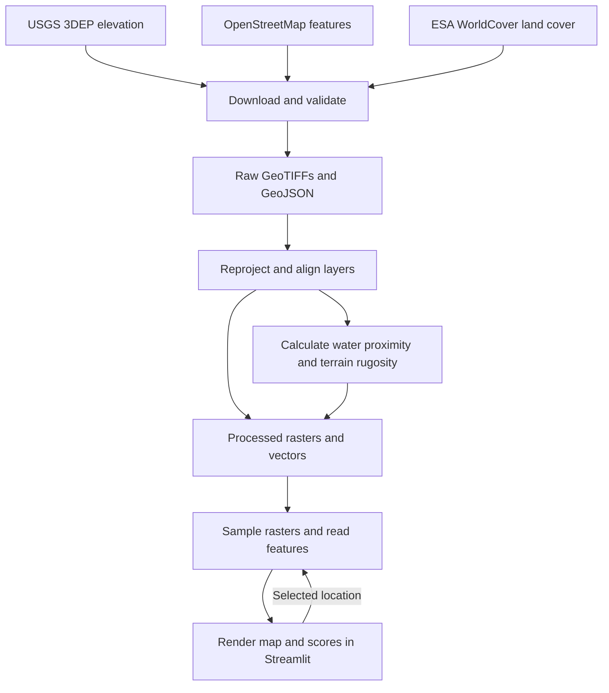

# Architecture

The park data pipeline runs before the interactive map opens. The Streamlit
app uses the resulting local layers to render the study area and display scores
when a user selects a location.

## System diagram

## Data flow

| Stage | Responsibility | Implementation |
| --- | --- | --- |
| Ingestion | Accept a WGS84 park bounding box, fetch elevation and land-cover rasters and selected OSM features, and validate the downloads before writing them to `data/raw/`. | Downloader in [fetch_data.py](../src/backend/fetch_data.py). |
| Spatial preparation | Reproject source layers into a common projected coordinate reference system (CRS), align rasters to a shared analysis grid, and preserve NoData masks. | Planned in [etl.py](../src/backend/etl.py). |
| Spatial analysis | Use water features to calculate proximity and the elevation raster to calculate terrain rugosity. Write aligned score rasters alongside the prepared layers in `data/processed/`. | Planned in [analysis.py](../src/backend/analysis.py). |
| Query and rendering | Use the selected map location to sample elevation and score rasters and retrieve nearby features. Show the results in a score panel alongside the Mapbox-styled map. | Planned in [app.py](../src/frontend/app.py) and the backend. |

The app converts map coordinates to the analysis CRS before sampling the local
rasters. Point queries use precomputed scores, with a target latency under
3 seconds at the 95th percentile. See [project goals](goals.md) for the
benchmark procedure.
